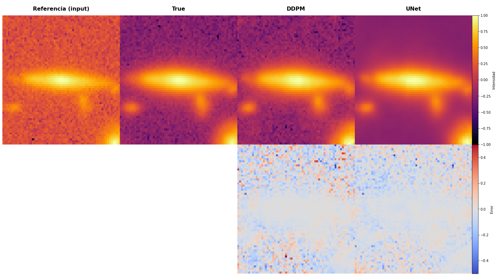
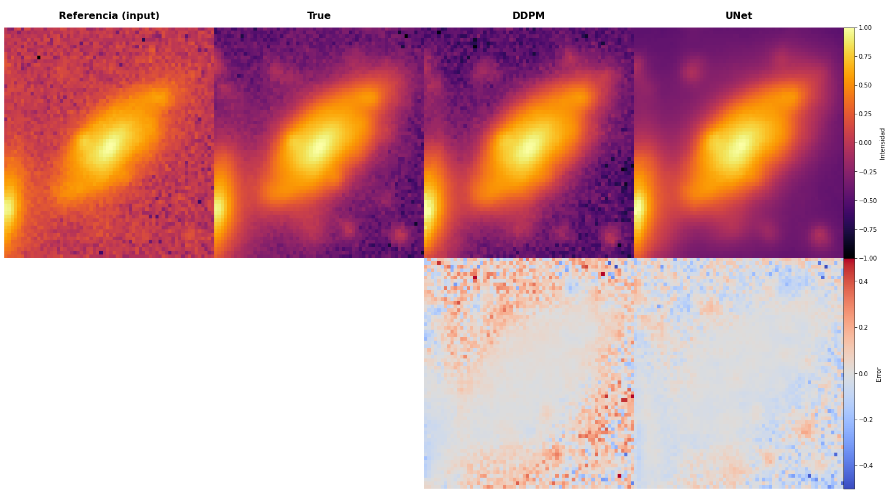
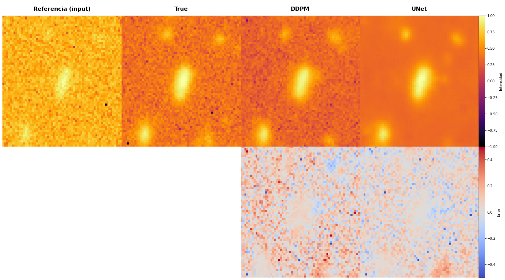

# Modelos DDPM para la Mejora de Imágenes Astronómicas

  

Este repositorio contiene parte del código fuente de mi Tesis de Máster, con implementaciones completas desde cero de las arquitecturas U-Net y de Modelos de Difusión utilizando PyTorch Lightning. La implementación incluye todos los componentes arquitectónicos, desde los bloques básicos hasta los flujos de entrenamiento completos.

## Descripción del Proyecto

La investigación aborda un desafío significativo en la astronomía observacional: mejorar imágenes de galaxias con baja Relación Señal-Ruido (SNR) sin necesidad de tiempo adicional de observación con telescopios. El proyecto implementa y compara dos enfoques de aprendizaje profundo, ambos construidos íntegramente desde componentes fundamentales:

1. Residual Attention U-Net (RAUNet)
  - Implementación personalizada de la arquitectura U-Net con innovaciones adicionales
  - Construida con conexiones residuales y mecanismos de atención
  - Incluye bloques personalizados para submuestreo, sobre muestreo y atención espacial
  - Diseñada para traducción directa de imagen a imagen

2. Guided Diffusion Model (DDPM)
  - Implementación completa de los procesos de difusión y eliminación de ruido
  - Programación de ruido y procedimientos de muestreo personalizados
  - Enfoque probabilístico con mecanismos de condicional
  - Capaz de generar múltiples soluciones para la estimación de incertidumbre

La investigación demostró que los modelos de difusión (DDPM) logran un rendimiento superior en la preservación de estructuras galácticas complejas en comparación con los enfoques tradicionales basados en U-Net. Aunque requieren datos de entrenamiento y recursos computacionales más extensos, la capacidad de los DDPM para generar múltiples soluciones proporciona estimaciones de incertidumbre valiosas para la investigación astronómica.

Esta implementación sirve como un marco para futuras investigaciones en la mejora de imágenes astronómicas y puede adaptarse para tareas de transformación similares con alta relación ruido/señal en imágenes científicas.

## Ejemplos

  

  

  

